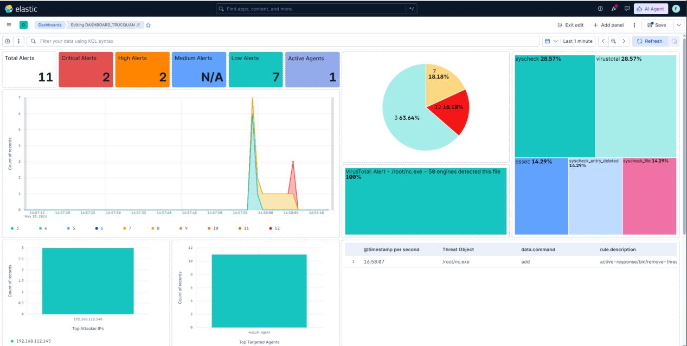
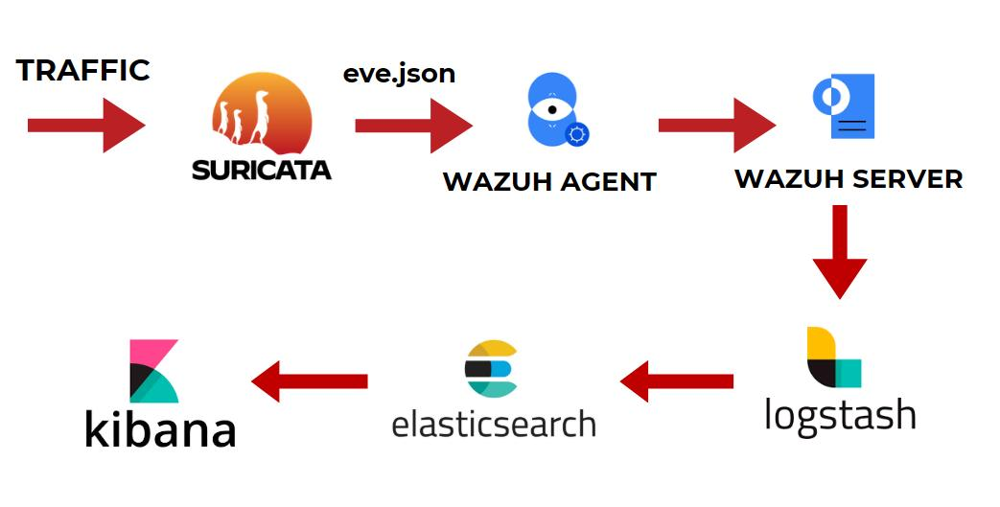
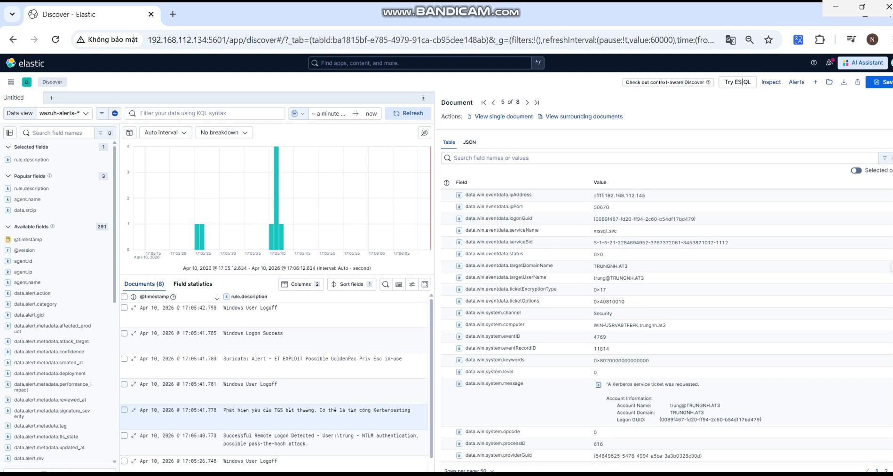
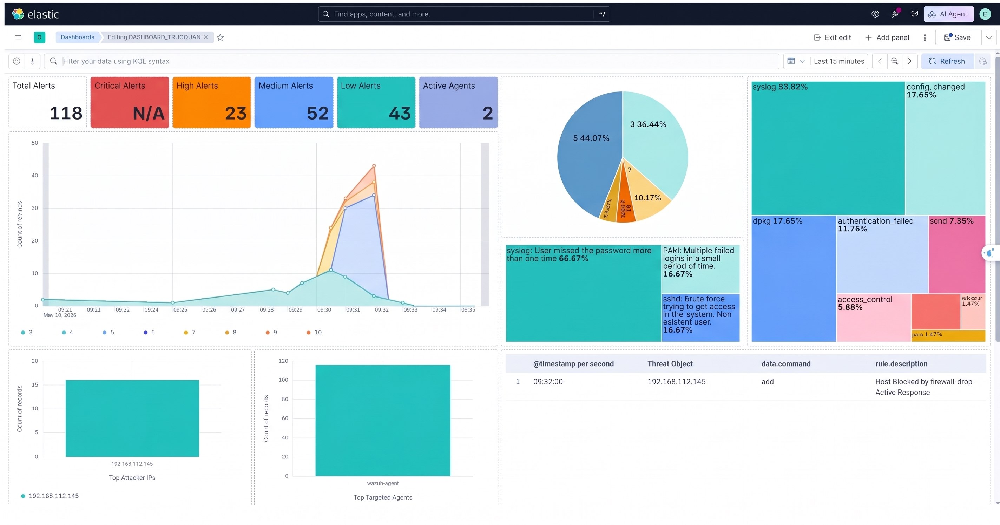
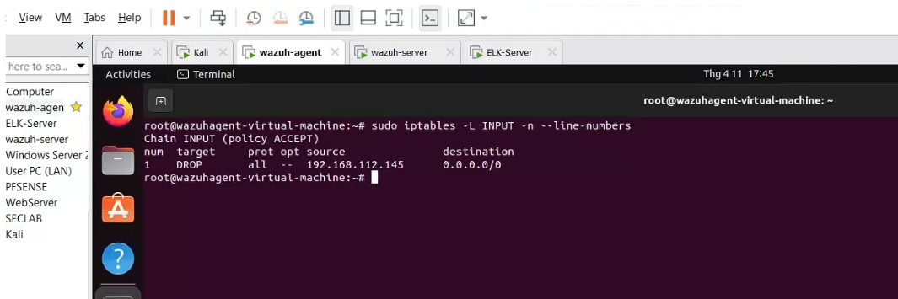

# 🛡️ Wazuh + ELK Stack + Suricata — Intrusion Detection Lab

**Centralized threat detection, investigation, and automated response with Wazuh, Suricata, and the Elastic Stack.**

This project implements a host-and-network intrusion detection system built around **three complementary components**:

- **Suricata — network intrusion detection:** inspects traffic on the monitored Ubuntu endpoint and writes network alerts to `eve.json`.
- **Wazuh — endpoint monitoring and centralized analysis:** collects Windows events, SSH authentication logs, file-integrity events, and Suricata logs; applies decoders and rules; coordinates Active Response.
- **ELK Stack — ingestion, search, and visualization:** Logstash forwards Wazuh alerts, Elasticsearch indexes them, and Kibana provides dashboards and event investigation.

**Academic topic:** Xây dựng hệ thống phát hiện xâm nhập dựa trên Wazuh và ELK Stack. The implemented architecture integrates **Suricata as its network IDS**, alongside Wazuh endpoint monitoring and the ELK analytics pipeline.

The project documents three scenarios: **Kerberoasting detection**, **malicious-file detection and removal**, and **SSH brute-force detection and IP blocking**.

> **Repository scope:** a documented lab portfolio with original experiment screenshots, architecture, detection logic, and observed results. It does not include a complete deployment bundle or exported Kibana saved objects.

## 📊 Results at a glance

| Scenario | Detection evidence | Observed response | Walkthrough |
|---|---|---|---|
| Kerberoasting | Suspicious TGS request, Windows Event 4769, service and source-IP context | Alert and investigation in Kibana | [Demo 01](demos/01-kerberoasting/README.md) |
| Malicious file | FIM event enriched with VirusTotal results for `/root/nc.exe` | `remove-threat.sh` removal event and file-deleted event | [Demo 02](demos/02-malicious-file/README.md) |
| SSH brute force | Repeated SSH authentication failures, Wazuh brute-force alert | `firewall-drop` response and an `iptables` DROP entry | [Demo 03](demos/03-ssh-brute-force/README.md) |

### What the lab demonstrates

- **Integrated network IDS:** Suricata events are collected by Wazuh and visible in Kibana, as demonstrated by the integration screenshots.
- **Centralized visibility:** endpoint and network events become searchable in Kibana.
- **Detection engineering:** Wazuh rules identify suspicious Kerberos activity and repeated SSH authentication failures; Suricata adds network visibility.
- **Threat enrichment:** VirusTotal results add file-reputation context to FIM events.
- **Automated containment:** file removal and temporary source-IP blocking are visible in response logs.
- **Investigation workflow:** dashboards summarize activity; Discover exposes the underlying event fields.

*Dashboard captured during the lab. Counts reflect the selected time range, not a measured detection rate.*

## 🏗️ Architecture

| Layer | Component | Responsibility |
|---|---|---|
| Host telemetry | Wazuh Agent | Windows Security events, FIM, local log collection |
| Network telemetry | Suricata | Traffic inspection and JSON alerts in `eve.json` |
| Detection | Wazuh Server | Decoding, rules, alert generation, response orchestration |
| Enrichment | VirusTotal integration | File-hash reputation lookup |
| Ingestion | Logstash | Read Wazuh alerts and forward them to Elasticsearch |
| Search | Elasticsearch | Index security events for investigation |
| Visualization | Kibana | Dashboards, filtering, and event inspection |
| Containment | Wazuh Active Response | Remove a flagged file or block a source IP |

**Network detection pipeline:** Network traffic → Suricata → `eve.json` → Wazuh Agent → Wazuh Server → `alerts.json` → Logstash → Elasticsearch → Kibana.

**Endpoint detection pipeline:** Windows Security / SSH authentication / FIM events → Wazuh Agent → Wazuh Server → the same ELK pipeline.

**Response path:** Wazuh Server → Active Response on the endpoint → file removal or firewall IP blocking.

[Architecture and environment](docs/architecture.md) · [Detection logic](docs/detection-logic.md) · [Evidence index](docs/evidence-index.md)

## 🌐 Suricata integration — network visibility

Suricata runs on the Ubuntu endpoint with capture interface **`ens33`** and monitored network **`192.168.112.0/24`**. The Wazuh Agent reads **`/var/log/suricata/eve.json`** as JSON and sends the events to Wazuh Server for analysis. The resulting alerts reach Kibana through Logstash and Elasticsearch.

**Observed integration result:** Kibana displays events with `rule.groups` containing `ids` and `suricata`, together with network-alert fields. This establishes network telemetry as part of the implemented system.

During the malicious-file demo, the event list also contains Suricata alerts associated with the executable download, alongside VirusTotal and file-removal events. Suricata contributes network context; Wazuh FIM, VirusTotal, and Active Response drive the file-verdict and removal workflow.

[View Suricata integration and its role in the three demos →](docs/suricata-integration.md)

## 🔎 Demo 01 — Kerberoasting detection

Windows Security Event **4769** is analyzed for suspicious service-ticket requests. The recorded alert exposes the service account, ticket encryption type, and requesting IP for investigation.

**Observed:** an alert for an abnormal TGS request, with source `192.168.112.145`, service `mssql_svc`, and ticket encryption type `0x17` in the recorded event. This scenario demonstrates detection; automated Kerberoasting prevention is not claimed.

[View detection logic, dashboard, and evidence →](demos/01-kerberoasting/README.md)

## 🧬 Demo 02 — Malicious-file detection and removal

FIM monitors the target directory. A file event triggers a VirusTotal lookup; a malicious result activates the removal response. Kibana shows both the reputation result and subsequent removal events.

**Observed:** the recorded result for `/root/nc.exe` has `positives = 51` and `total = 71`. The event list includes `File deleted.` and a `remove-threat.sh` message identifying the removed file. These values describe the captured sample and lookup, not a general accuracy score.

[View FIM, enrichment, and response evidence →](demos/02-malicious-file/README.md)

## 🔐 Demo 03 — SSH brute-force detection and IP blocking

Repeated SSH authentication failures on the monitored endpoint trigger a Wazuh brute-force alert. Active Response invokes `firewall-drop` for rule **5763**, with a configured **180-second** timeout.

**Observed:** Kibana shows SSH authentication failures, a brute-force alert, and `Host Blocked by firewall-drop Active Response`. The endpoint firewall contains a DROP rule for **192.168.112.145**.

[View configuration, simulation, dashboard, and blocking evidence →](demos/03-ssh-brute-force/README.md)

## 📂 Repository guide

| Path | Contents |
|---|---|
| [`demos/01-kerberoasting/`](demos/01-kerberoasting/README.md) | Kerberos detection walkthrough |
| [`demos/02-malicious-file/`](demos/02-malicious-file/README.md) | FIM, VirusTotal, and removal workflow |
| [`demos/03-ssh-brute-force/`](demos/03-ssh-brute-force/README.md) | SSH detection and firewall response |
| [`docs/architecture.md`](docs/architecture.md) | Components, log flow, and environment |
| [`docs/suricata-integration.md`](docs/suricata-integration.md) | Network IDS configuration, collection, and ELK evidence |
| [`docs/detection-logic.md`](docs/detection-logic.md) | Detection conditions and interpretation |
| [`docs/results.md`](docs/results.md) | Evidence-backed outcome matrix |
| [`docs/evidence-index.md`](docs/evidence-index.md) | Screenshot-to-report mapping |
| [`docs/github-publishing.md`](docs/github-publishing.md) | Upload instructions and repository metadata |
| [`screenshots/`](screenshots/) | Original embedded report images |

## 🧠 Technical takeaways

- Combining host and network telemetry supports investigation across different sources.
- Detection and response need separate evidence: an alert alone does not prove containment.
- Suricata supplies network alerts while Wazuh combines them with endpoint telemetry for centralized analysis.
- FIM identifies file changes; reputation enrichment helps decide which changes need a response.
- Dashboard totals depend on time filters and can include unrelated background events.

## 🔭 Next steps

- Export and version the original rules, agent settings, and Kibana saved objects.
- Measure ingestion latency, false-positive rates, and response completion time.
- Test response rollback, firewall timeout expiry, and legitimate-traffic behavior.
- Tune detections against a documented benign baseline.

## Evidence basis

Architecture, Kerberoasting, and malicious-file evidence come from the project report, principally pages **27–49**. SSH brute-force evidence comes from the supplementary **`demossh.docx`** document. See the [evidence index](docs/evidence-index.md) for exact figure references. The screenshots preserve the captured lab state; no new execution or performance benchmark is implied.
